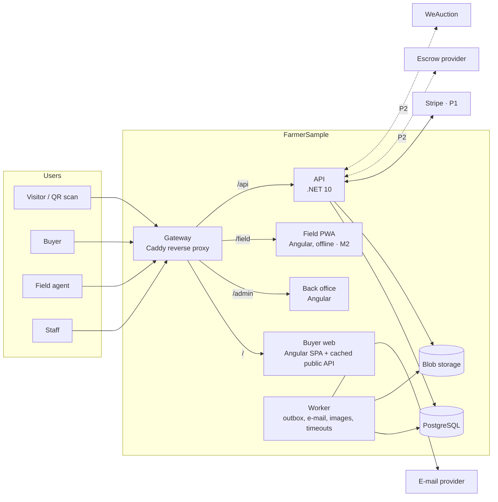
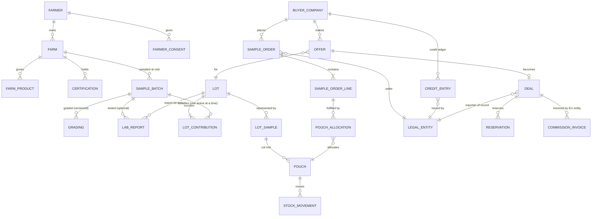
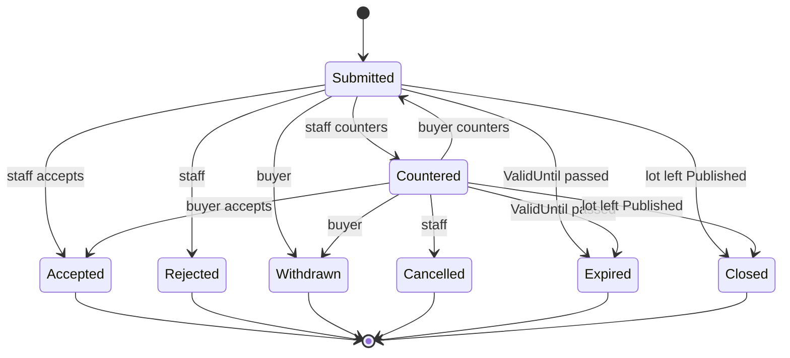

# FarmerSample.com — Development Architecture (v0.3)

Status: draft for review · Owner: Paul (WeAuction) · Source: FarmerSample.com Business Plan draft v0.1 (9 Nov 2026)

Changes in v0.3: public pages are live SPA routes on a cached public API (no static regeneration); reservation lifecycle; volume-weighted composite samples; stock movements as from/to; M1 must/should cut line; sample requests stored; stronger consent evidence; demo command needs only Docker; Stripe races closed.

Changes in v0.2: grading moved to the per-farm sample batch and lot samples made explicit; M1 slimmed to a weeks-sized showcase; one DbContext; Stripe flow hardened; legal entity on every money record; GDPR scope and farmer consent corrected; document redaction; offline-PWA realities; state machines completed; single gateway; one cross-platform command set.

## 0. Summary of decisions

| # | Decision | Choice |
|---|----------|--------|
| D1 | Overall shape | **Modular monolith, kept light**: one .NET API project with modules as folders/namespaces, **one EF Core DbContext**, one PostgreSQL database (a schema per module for tidiness, cross-module foreign keys allowed). Three Angular front-ends behind one gateway. Split further only when a boundary actually hurts. |
| D2 | Stack | **.NET 10 (LTS) / C#**, ASP.NET Core, **EF Core 10 + Npgsql**, **PostgreSQL 17**, **Angular (current stable at scaffold time)**. Same family as WeAuction (.NET/C#, Angular, Azure), so Enigmatry and WeAuction developers can work on it. |
| D3 | Local first | The full stack runs on a laptop (Windows, macOS incl. Apple Silicon, Linux) with Docker Compose. **Demo mode needs only Docker.** Every cloud dependency has a local stand-in (Azurite, Mailpit; Stripe test mode is optional and off by default). |
| D4 | Cloud later | Azure (Container Apps, Database for PostgreSQL Flexible Server, Blob Storage, Key Vault) in an EU region (West Europe / Spain Central). A small `test` environment may come early for the EDB demo (§10.7). |
| D5 | Auctions | **Not rebuilt.** Phase 2 auctions run on the existing **WeAuction platform** via an integration adapter. |
| D6 | Money | FarmerSample **never holds third-party money**. P1: the EU entity sells samples/boxes via Stripe; the exporter of record invoices goods directly to the buyer; FarmerSample invoices its commission. P2 escrow only through a **regulated provider**. |
| D7 | Anti-bypass by design | Farmer contact details, legal names of plantations (unless the farmer consents to show them) and exact GPS are **never** exposed to buyers — not in JSON, QR pages, images, PDFs or exports. Conscious exception: in P1 the buyer learns the **exporter of record** (Saj's company or a licensed exporter), who is our partner; farmer identities stay off exporter paperwork shown to buyers. |
| D8 | Field data capture | **M1:** mobile-friendly back-office intake form + import of the EDB plantation spreadsheet. **M2:** true offline PWA for farm visits. |

## 1. Context

### 1.1 What the business needs, by phase

| Phase | When | Business capability | Platform scope |
|-------|------|---------------------|----------------|
| P0 Showcase | Nov 2026 – Jan 2027 | Show the EDB, farmers and first buyers what we do | Public site, farm profiles, QR pages, "request a sample" form, back office (see M1, §15) |
| P1 Sample showroom | Feb – Sep 2027 | Paid samples and discovery boxes, offers, negotiated deals (5 % commission), closed buyers group, EU sample stock | Buyer accounts (invite only), catalogue with "valid until" + volume, Stripe, sample credits, offers, deals, sample inventory (LK hub + EU stock), offline field app, KPI dashboard |
| P2 Deals + auctions | from Oct 2027 | Escrow, logistics, timed auctions every two weeks, live hybrid in peak season, memberships, Ceylon Spice Awards | Escrow via provider, shipments/documents, WeAuction integration, memberships, competition |
| P3 Kerala | 2029 | Second country, INR, local partner | Reference data + country rules (model is multi-country from day one) |

The business plan's phase-gate numbers must be measurable from platform data (§11).

### 1.2 Users and roles

| Role | Who | App |
|------|-----|-----|
| Visitor | Anyone, incl. QR scanners | Buyer web (public) |
| Buyer / buyer admin | Invited importers, grinders, packers, retailers | Buyer web |
| Field agent | Saj's team on farm visits | Back-office intake form (M1), field PWA (M2) |
| Quality controller | Hub staff: grading, sealing, labels | Back office |
| Sales/ops | Paul, Saj, ops coordinator | Back office |
| Admin | Settings, users, legal entities | Back office |

Farmers do not log in in P0–P1; staff manage their profiles with the farmer's recorded consent (§9.2).

### 1.3 Constraints and quality goals

- **Tiny team, first version in weeks** (EDB meeting). Build the minimum (§15) and grow.
- **Trust and auditability** of gradings, seals, prices and deals.
- **Bypass protection** (D7) is business-critical.
- **Low bandwidth** at farms and on buyers' phones.
- **Two legal entities** (Sri Lankan: sourcing, hub, export; European: sample stock, sample sales, buyer contracts, commission, later escrow contracting). **Every money record names its legal entity.**
- **Privacy**: GDPR applies to **all** personal data processed by the EU entity — buyers *and* farmers (names, photos, stories, farmer-share figures). Sri Lanka PDPA (No. 9 of 2022) applies to processing in Sri Lanka. Minimise farmer data.
- **Cost** well within the EUR 24k/year platform budget.

## 2. Principles

1. **Small now, clean seams.** Modules are namespaces with a public `Contracts` surface; code in one module calls another only through its `Contracts`. The database may use cross-module foreign keys for integrity.
2. **Local parity.** Same containers and topology locally and in Azure; only configuration differs.
3. **Design for P2, build for P0/P1.** Model lots, money, entities, countries properly; don't build escrow or auctions.
4. **Server is the source of truth.**
5. **Derived state is derived.** Reserved volume, pouch location and "partly reserved" are computed from movements/reservations, not stored as independent truths.
6. **Public by allow-list.** Public/buyer DTOs and documents are separate, explicitly approved representations.

## 3. System context



One origin for everything (`/`, `/admin`, `/field`, `/api`) so session cookies are same-site everywhere, locally and in Azure. The gateway is a Caddy container with a small Caddyfile.

## 4. Technology stack

| Concern | Choice | Notes |
|---------|--------|-------|
| Backend | .NET 10 LTS, ASP.NET Core Minimal APIs, one project per deployable (`Api`, `Worker`, `DbMigrator`) + `Core` library holding the modules | LTS to Nov 2028 |
| Data | EF Core 10 + Npgsql, one `AppDbContext`, schemas per module | `xmin` optimistic concurrency for ordinary edits; explicit `SELECT … FOR UPDATE` (via `FromSql`/`ExecuteSql` inside the transaction) only for reservations and offer acceptance |
| Database | PostgreSQL 17 | Multi-arch image; Azure Flexible Server later |
| Files | Azure Blob Storage SDK; Azurite locally | Private containers; public renditions only via API/CDN |
| Background work | Transactional outbox table + `BackgroundService` in the Worker | Also runs timeouts (holds, offer expiry) |
| Auth | ASP.NET Core Identity, HttpOnly SameSite=Lax cookies, antiforgery header; **TOTP MFA required for staff** (passkeys later) | No tokens in the browser |
| API contract | OpenAPI generated at build; TypeScript client generated for Angular | |
| Front-end | One Angular workspace: `buyer-web`, `backoffice`, `field` (M2) + shared libs. Public pages (`/q/{code}`, farm and lot pages) are **ordinary SPA routes** reading `/api/public/...`, which is anonymous, rate-limited and HTTP-cached (`Cache-Control: public, max-age=60`, ETag). Publishing, unpublishing or consent withdrawal is visible within a minute, with no rebuild. Visitors arrive via QR, so SEO is not a P0 need; if link previews (WhatsApp) or SEO become important, add small Razor-rendered `/q` and farm pages served by the API (no Node SSR server) | |
| i18n | **Transloco** (runtime language switching) in all apps; English first, Sinhala/Tamil for field screens and farmer consent texts | |
| UI | Angular Material + design tokens | |
| Payments | Stripe Checkout (P1), **cards first**; add iDEAL/Bancontact later if buyers ask; no delayed-settlement methods (SEPA DD) in P1 | §7.3 |
| E-mail | Azure Communication Services Email or Postmark; Mailpit locally | |
| Observability | OpenTelemetry → Aspire Dashboard container locally; Application Insights in Azure | Cheap to add at M0 |
| Tests | xUnit, Testcontainers (PostgreSQL), Playwright smoke (from M2) | |
| CI | GitHub Actions | |

## 5. Modules

Start (M0–M1) with four modules; the rest are added when their milestone starts. All live in `FarmerSample.Core` under `Modules/<Name>` with a `Contracts` sub-namespace.

| Module | Milestone | Owns | Key rules |
|--------|-----------|------|-----------|
| Identity | M0 | Staff and buyer users, buyer companies, invitations, roles | Buyers invite-only; staff MFA |
| Supply & Quality | M1 | Farmer, Farm, FarmProduct, Certification, **FarmerConsent**, SampleBatch, **Grading** (per batch), LabReport, **Lot**, LotContribution, LotSample | Gradings immutable/versioned; a lot's contributions share product + grade |
| Catalogue | M1 | Public API for farm/lot pages, QR resolution, buyer lot listing, **SampleRequest** records (M1) | Built only from allow-listed fields and `BuyerSafe` documents; sample requests stored in the DB (first funnel data) and e-mailed to staff; form protected by rate limit + honeypot + Cloudflare Turnstile |
| Admin | M1 | Legal entities, countries, regions, currencies, FX rates, settings, audit log | |
| Samples | M2 | Pouches, stock locations, stock movements, EU consolidated shipments, labels | Location derived from movements |
| Orders & Payments | M2 | Sample orders, discovery boxes, Stripe, refunds, **credit ledger** | Legal entity on every record |
| Trading | M3 | Offers, versions, deals, reservations, commission | §6.3 |
| Messaging | M3 | Buyer ↔ staff threads | Contact-detail warning on outgoing staff messages |
| Reporting | M3 | KPI views and dashboard | SQL views over module tables (§11) |
| Integrations | M2+ | `IPaymentGateway`, `IEmailSender`, `IAuctionPlatform`*, `IEscrowProvider`*, `IFxRateSource` with fakes | `*` P2 |

An architecture test (NetArchTest) checks that types in `Modules.X` only reference `Modules.Y.Contracts`.

## 6. Domain model

### 6.1 Entities



**From farm to lot — the physical truth**

1. **SampleBatch** = 1–2 kg taken from one farm at one visit, for one product. It is dried and **graded per farm** (moisture, density g/L, cleanliness, grade). A lab report may be attached when a buyer is serious.
2. **Lot** = sellable volume of one product + one grade, from **one or more farms** (bundling). A `LotContribution` links a farm's graded batch and the volume (kg) that farm commits. Rule: all contributions have the same product and confirmed grade; the lot's grade is confirmed by QC when the lot is created.
3. **LotSample** = the physical sample buyers receive for that lot:
   - single-farm lot → the farm's batch itself;
   - bundled lot → a **composite** made by QC from **volume-weighted** portions of the contributing batches (a farm committing 80 % of the volume supplies 80 % of the composite; QC may override with a reason), ratio recorded, re-checked for grade. Per-farm batch remainders are kept as **retained reference samples** for disputes.
4. **Pouch** = a numbered, sealed portion of a LotSample (with a printed seal number and a QR to the lot page).

The QR/lot page of a bundled lot lists all contributing farms (public profile names only) and each farm's share of the volume.

**Key attributes**

- **Lot**: `PublicCode` (random, §6.2), product, grade, country, region(s), harvest window, committed volume (kg; sum of contributions), indicative price range (min/max per kg, currency, Incoterm), `ValidUntil`, status `Draft → Published → Closed(SoldOut | Expired | Withdrawn)`. *Reserved/available volume is derived* from active reservations.
- **Pouch**: `PublicCode` (random), `SealNumber` (sequential, physical only), weight (g), LotSample, status `Active | Consumed | Destroyed`. *Location derived* from the latest `StockMovement`, which records `fromLocation`, `toLocation`, type (`Created`, `Transfer`, `Received`, `Picked`, `ShippedToBuyer`, `Delivered`, `Destroyed`), timestamp and reference. Pouches can be picked from the LK hub or from EU stock.
- **Grading**: sample batch or lot sample, moisture %, density g/L, cleanliness, grade, operator, timestamp, photos, version, `SupersedesId` + reason.
- **SampleOrder**: buyer company, **legal entity (seller)**, lines, totals incl. VAT, Stripe session + payment intent IDs, ship-from location, status.
- **SampleOrderLine**: either a single lot sample (qty 1) or a **discovery box** (a curated box definition listing N lots); fulfilment creates `PouchAllocation`s (one per lot) at pick time. At checkout we reserve **quantity per lot and stock location**, not specific pouches.
- **CreditEntry**: buyer company, **legal entity**, amount + currency, type (`SamplePurchase`, `Refund` (negative), `Redemption` (negative), `Expiry`), source document, timestamp. Balance = sum.
- **Offer**: lot, buyer company, volume kg, price/kg, currency, Incoterm, delivery window, `ValidUntil`, status, versions (each counter = new version).
- **Reservation**: lot, deal, kg, status `Active → Consumed` (deal Shipped/Completed) `| Released` (deal Cancelled). **Available volume = committed − Active − Consumed.**
- **Deal**: accepted offer version, exporter of record (legal entity), commission % and amount, status `Agreed → Contracted → Shipped → Completed | Cancelled`.
- **CommissionInvoice** (EU entity → buyer): commission/service fee, **sample credit redeemed here** as a line, VAT per EU rules.

### 6.2 Conventions

- **Money**: minor units (`long`) + ISO-4217 (EUR, USD, LKR; INR later). FX conversions store rate + source + date.
- **Weights** in grams (`long`); density g/L; API exposes kg with explicit units.
- **IDs**: UUID v7 internally. **Public codes**: 8-character Crockford base32 with a check character, random (not sequential), e.g. `LT-7KQ2-M9XD`, `PO-3HV8-1ZRC`. Sequential numbers exist only on physical seals and are not resolvable.
- **Time**: UTC stored; `DateTimeOffset`; displayed in user time zone.
- **Reference data**: countries (ISO-3166), our regions (Gampola/Kandy, Bibile, Middeniya, Maspanna to start), products, grade scales per product, Incoterms.

### 6.3 State machines and invariants

**Offer**



("Under review" is a UI flag, not a state.)

Invariants:

- **Accept** creates a Deal and a `Reservation` for the volume in **one transaction**, guarded by a row lock on the lot (`SELECT … FOR UPDATE`) so that `committed − active reservations ≥ requested` holds under concurrency.
- **Deal Cancelled** releases its reservation in the same transaction; **Deal Shipped** marks it Consumed.
- A sample batch has at most one **active** lot contribution (successor lots after withdraw/expiry may reuse it).
- When a lot reaches zero available volume or leaves `Published`, the worker closes open offers on it and notifies buyers.
- The worker expires offers and lots on `ValidUntil`.
- A lot cannot be edited in product/grade once it has offers; a change means withdraw + new lot.

## 7. Key flows

### 7.1 Farm intake

**M1 (online form + import):** field agent or staff fills a mobile-friendly back-office form (farmer, farm, products, hectares, harvest window, certifications, photos, sample batch, **consent**); the form saves a draft in `localStorage` while editing. EDB plantation spreadsheets can be imported (CSV/XLSX mapping screen) as draft farms. All intake lands as **"needs review"**; staff publish.

**M2 (offline PWA):**
- Records get client-generated UUIDs; stored in IndexedDB with an outbox; app calls `navigator.storage.persist()` and shows a persistent "N records not yet synced" banner.
- Sync: `PUT /api/v1/intake/{clientId}` (idempotent upsert); photos upload via short-lived, write-only SAS URLs, then confirm.
- If the session expired while offline, the app asks the agent to log in again and **resumes the outbox**; nothing is lost.
- After successful sync, local copies of personal data and photos are **deleted from the device** (device loss = PDPA incident risk).
- Edits after sync happen only in the back office.

The worker creates public image renditions (resized WebP, **all metadata stripped**). Original photos stay private.

### 7.2 Grade, bundle, list

1. Hub receives the batch (scan batch label), dries, grades → `Grading` on the batch.
2. QC creates a Lot from one or more graded batches of the same product + grade, records volumes per farm.
3. QC makes the LotSample (single batch or composite with ratio), re-grades if composite, splits into pouches, prints labels (PDF sheet: public code + QR + seal number).
4. Staff sets price range, `ValidUntil`, approves **buyer-safe** media/documents (§9.3), publishes. Catalogue pages regenerate.

### 7.3 Order a sample or discovery box (M2)

```mermaid
sequenceDiagram
  participant B as Buyer
  participant A as API
  participant S as Stripe
  participant W as Worker
  B->>A: POST /sample-orders (Idempotency-Key)
  A->>A: reserve qty per lot+location, hold until T+30 min
  A->>S: Checkout Session (expires_at = T+30 min, cards)
  A-->>B: redirect
  B->>S: pays
  S-->>A: checkout.session.completed (signature, event id dedup)
  A->>A: if payment_status=paid → Paid, CreditEntry(+), outbox e-mail
  A->>A: if hold already released → try to re-reserve from current stock; refund only if truly out of stock, notify staff
  S-->>A: checkout.session.expired → release hold
  S-->>A: charge.refunded → CreditEntry(−), order Refunded
  W->>W: safety net: for overdue holds, retrieve the session from Stripe; release only if status = expired
```

- Stripe Checkout's minimum `expires_at` is 30 minutes, so hold and session expire together.
- Webhooks are stored by Stripe event ID before processing (idempotent).
- P1 accepts **cards only** (immediate settlement). If asynchronous methods are added later, handle `checkout.session.async_payment_succeeded/failed`.
- Fulfilment: staff picks pouches (EU stock for EU buyers, 1–3 days), which creates `PouchAllocation`s and `StockMovement`s, and enters courier tracking manually.
- **Payments switched off** (`Payments:Enabled=false`, the default locally and in M1): orders become free "sample requests" handled by staff.

### 7.4 Offer → deal (M3)

Buyer makes an offer → staff and buyer counter in the offer thread → accept (invariants §6.3) → Deal with exporter of record → exporter invoices goods **directly to the buyer** (contract/invoice PDFs uploaded to the deal) → EU entity issues a **CommissionInvoice**; the buyer's available **sample credit is redeemed as a line on that invoice** (same entity that collected it, so no cross-entity or cross-VAT settlement). Commission 5 % in P1, configurable per deal.

### 7.5 QR scan

`https://<public-base-url>/q/{publicCode}` → lot or farm page (SPA route on the cached public API): farm story, region (no exact location), products, certifications, structured lab summary (not the PDF), for bundled lots all contributing farms. Unknown codes return 404 without hinting. Rate-limited.

## 8. Front-end applications

| App | Gateway path | Rendering | Milestone |
|-----|--------------|-----------|-----------|
| `buyer-web` | `/` | SPA; public pages read the cached public API | M1 public, M2 buyer area |
| `backoffice` | `/admin` | SPA, staff MFA | M1 |
| `field` | `/field` | Offline PWA, phone-first, runtime EN/SI/TA | M2 |

Shared libs: `ui`, `api-client` (generated), `i18n`, `auth`.

**Developer mode:** Angular dev servers run on the host with `proxy.conf.json` sending `/api` to the API, served under `localhost` (secure context, cookies same-origin).
**Demo/cloud mode:** the gateway serves built apps and proxies `/api` → identical topology.

## 9. Security and privacy

### 9.1 Access
- Identity cookies (HttpOnly, Secure outside localhost, SameSite=Lax), antiforgery header on mutating requests.
- Staff: TOTP MFA mandatory. Buyers: invite link → password; MFA optional.
- Resource policies: a buyer sees only its own company's orders, offers, deals, credits. Policies unit-tested.
- Rate limiting on login, public, QR, offer and order endpoints.
- Secrets: never in git; `.env` (git-ignored) + `.env.example`; Key Vault + managed identity in Azure.

### 9.2 Personal data (GDPR + PDPA)
- **Controllers:** to be confirmed with counsel (§16): working assumption — the EU entity controls buyer data and published farmer profiles; the Sri Lankan entity controls intake data in Sri Lanka and transfers it to the EU entity under a documented PDPA cross-border basis (s.26) with a data-sharing agreement.
- **FarmerConsent** captured at intake, in the farmer's language (Sinhala/Tamil/English): purposes (public profile, photos, family story, showing the farmer's price share, showing the plantation's legal name), who obtained it, when, the **consent text version** shown, and evidence. Default evidence is a **photo of the signed paper form**; an agent tick after reading the text aloud is a recorded fallback only, and is not enough for publishing photos of people. Withdrawal unpublishes within 48 h.
- **Data minimisation:** no NIC numbers or bank details in P0–P1 (FarmerSample does not pay farmers). Phone numbers only for staff contact, stored in an internal table excluded from all public/buyer projections.
- Retention schedule and data-subject request procedure in `docs/privacy.md`.
- **Audit log** stores user IDs and entity IDs plus changed **non-personal** fields; personal-field changes are logged as "field X changed" without values, so erasure does not conflict with an append-only log.

### 9.3 Bypass protection (D7) — all channels
- **JSON:** public/buyer DTOs are explicit allow-lists. A **canary test** seeds farmers with marker phone numbers, e-mails, legal names and GPS, calls every public/buyer endpoint, and fails if any marker appears.
- **Documents:** buyers never receive originals (lab reports, certificates, phytosanitary documents). They get either **structured values** or a staff-redacted copy flagged `BuyerSafe=true` with reviewer + timestamp. Unflagged documents cannot be attached to buyer-visible views (enforced in code).
- **Photos:** re-encoded without metadata; review step checks for visible signs, nameplates and phone numbers before `BuyerSafe`.
- **Messages:** outgoing staff messages are scanned for phone/e-mail patterns (warning, not block).
- **Exporter paperwork** shown to buyers carries the exporter's identity, not individual farmers'.

### 9.4 Payments
Stripe signature verification, event-ID dedup, no card data on our servers (Checkout hosted page).

## 10. Local-first development environment

### 10.1 Prerequisites
- **Demo mode:** Docker Desktop (or Docker Engine/Podman with Compose v2). Nothing else: run `docker compose -f deploy/docker-compose.yml --profile app up --build -d` (the `npm run demo` script is the same command for developers who have Node).
- **Developer mode:** + .NET 10 SDK, Node.js LTS, Git.

### 10.2 Repository layout
```
farmersample/
├── package.json               single cross-platform command entry (npm scripts)
├── .env.example
├── docs/                      ARCHITECTURE.md, adr/, privacy.md
├── src/
│   ├── FarmerSample.Api/
│   ├── FarmerSample.Worker/
│   ├── FarmerSample.DbMigrator/       migrations + fictional seed data
│   └── FarmerSample.Core/
│       ├── SharedKernel/              Money, Weight, PublicCode, Result, events
│       ├── Modules/Identity|SupplyQuality|Catalogue|Admin|…/
│       └── Integrations/              Stripe, e-mail, fakes; WeAuction/escrow stubs
├── tests/  UnitTests, IntegrationTests (Testcontainers), ArchitectureTests, e2e/ (Playwright)
├── web/    Angular workspace: projects/buyer-web, backoffice, field; libs/*
└── deploy/
    ├── docker-compose.yml
    ├── Caddyfile
    └── azure/ (Bicep, M4)
```

### 10.3 Compose services

| Service | Image | Host port | Profile | Notes |
|---------|-------|-----------|---------|-------|
| `postgres` | `postgres:17` | 5432 | default | volume `pgdata`, healthcheck |
| `azurite` | `mcr.microsoft.com/azure-storage/azurite` | 10000 | default | blob only |
| `mailpit` | `axllent/mailpit` | 8025 (UI), 1025 | default | |
| `dashboard` | `mcr.microsoft.com/dotnet/aspire-dashboard` | 18888 (UI), 4317→18889 (OTLP gRPC), 4318→18890 (OTLP HTTP) | default | `DOTNET_DASHBOARD_UNSECURED_ALLOW_ANONYMOUS=true` (local only) |
| `migrator` | built | – | `app` | runs migrations + seed, exits; others `depends_on: service_completed_successfully` |
| `api` | built | – | `app` | |
| `worker` | built | – | `app` | |
| `gateway` | `caddy` + built Angular apps | **8080** | `app` | `/`, `/admin`, `/field`, `/api` |
| `stripe-cli` | `stripe/stripe-cli` | – | `payments` | needs `STRIPE_API_KEY` in `.env` |

Images are multi-arch (amd64/arm64), so Apple Silicon runs natively.

### 10.4 Commands (npm scripts, same on every OS)

| Command | Does |
|---------|------|
| `npm run setup` | creates `.env` from `.env.example`, `dotnet tool restore`, `npm ci` in `web/` |
| `npm run infra` | `docker compose up -d` (Postgres, Azurite, Mailpit, dashboard) |
| `npm run db` | migrations + fictional seed (farms in Kandy/Bibile, bundled lot, pouches, demo buyers, staff users); prints local logins |
| `npm run api` / `npm run web` | API (`dotnet watch`) / Angular dev servers |
| `npm test` | unit + architecture + integration tests (Testcontainers) |
| `npm run e2e` | Playwright against demo mode (checkout tests only with `payments` profile) |
| `npm run demo` | `docker compose --profile app up --build` → everything at `http://localhost:8080` |
| `npm run reset` | removes volumes, rebuilds |

Local uses **plain HTTP on `localhost`** (browsers treat it as a secure context); no dev certificate trust step.

### 10.5 Payments locally (optional)
1. Put Stripe **test** keys in `.env`, set `Payments__Enabled=true`.
2. `docker compose --profile payments up stripe-cli` runs `stripe listen --forward-to $STRIPE_FORWARD_TO`. Demo mode: `gateway:80/api/v1/webhooks/stripe`. Developer mode (API on the host): `host.docker.internal:<api-port>/api/v1/webhooks/stripe` (on Linux the service sets `extra_hosts: ["host.docker.internal:host-gateway"]`). Copy the printed `whsec_…` into `.env` as `Stripe__WebhookSecret`, restart `api`.
Without this, the app runs with payments off (sample requests).

### 10.6 Testing the field PWA on a real phone (M2)
Service workers and camera need a secure context; `http://<LAN-IP>` is not one. Options:
- Android via USB: `adb reverse tcp:8080 tcp:8080`, open `http://localhost:8080/field`.
- Any phone: `mkcert` certificate for the laptop's LAN name, enabled in the Caddyfile (`npm run demo:lan`).
- Or a tunnel (below).

### 10.7 The EDB demo (QR on a phone)
`PublicBaseUrl` is configurable and is what QR codes encode. For a demo, either run `cloudflared tunnel --url http://localhost:8080` (temporary public HTTPS URL) and print demo labels with that URL, or stand up the cheap Azure `test` environment early. Production labels always use `https://farmersample.com/q/…`.

## 11. Reporting and phase gates (M3)

SQL views over module tables, shown on a back-office dashboard with CSV export:

| Metric (business plan target) | Computed from |
|-------------------------------|---------------|
| Buyers ordering samples (20+), repeat buyers (10+) | paid SampleOrders per buyer company |
| Sample → offer (10–20 %) | offers on a lot by a company within 60 days of a delivered sample or a fulfilled sample request of that lot |
| Offers that close (first 5–10 deals) | Deals `Completed` |
| Price to farmer vs local traders | deal farmer share vs reference price entered by staff |
| Farm visit → sample in EU (~2 weeks) | SampleBatch created → StockMovement `Received@EU-stock` |
| Sample → offer time (≤ 1–1.5 months) | Delivered → Offer submitted |

## 12. Quality and testing
- Unit tests: money, public codes, state machines, reservations, credit ledger.
- Integration tests on real PostgreSQL (Testcontainers), incl. a concurrency test for two simultaneous accepts.
- Architecture test (module references).
- Privacy canary test (§9.3) runs in CI on every PR.
- OpenAPI diff in CI.
- Playwright smoke from M2: QR page, buyer login, sample request; offer → deal added in M3; checkout only in the `payments` job.

## 13. Path to Azure (M4, or a minimal `test` early)

| Local | Azure |
|-------|-------|
| `gateway` (Caddy + built apps) | Container App with external ingress — the only public entry |
| `api`, `worker` | Container Apps with internal ingress (worker none) |
| `migrator` | Container Apps Job, run before a new revision gets traffic |
| `postgres` | Database for PostgreSQL Flexible Server (Burstable), backups + PITR |
| `azurite` | Blob Storage (private), CDN for public renditions |
| `mailpit` | Azure Communication Services Email / Postmark |
| `dashboard` | Application Insights (OTLP) |
| `.env` | Key Vault + managed identity |

Bicep + GitHub Actions; `main` → `test`, tags → `prod`.

## 14. P2+ extension points (designed, not built)
- **Auctions (WeAuction):** `IAuctionPlatform.PublishLot`, result webhook `LotSold` → Deal via Trading. Bidding, streaming, live hybrid stay in WeAuction.
- **Escrow:** `IEscrowProvider` (create, fund, release on shipment/acceptance, refund); provider and EU-entity role decided with legal advice.
- **Logistics & documents:** shipments and export documents on deals (`BuyerSafe` rule applies).
- **Membership**, **Ceylon Spice Awards**, **Kerala** (reference data + country rules, e.g. no cardamom), **farmer notifications** (SMS/WhatsApp), **own trading book** (separate entity as an ordinary buyer, disclosed house bids).

## 15. Delivery plan

| Milestone | Target | Content |
|-----------|--------|---------|
| **M0 Skeleton** | week 1 | Repo, Compose + gateway, npm scripts, CI, Identity (staff only), AppDbContext + migrator + seed, OTel to dashboard |
| **M1 Showcase (P0)** | weeks 2–4, before the EDB meeting | **Must:** back-office CRUD for farmers, farms, photos (buyer-safe approval), consent, sample batches, gradings, single-farm lots; mobile-friendly intake form; public farm + lot pages and QR; stored "request a sample" form → staff e-mail; demo via tunnel or `test` env. **Should (cut first if the date is at risk):** bundled lots + composite samples, label PDF, EDB spreadsheet import |
| **M2 Showroom (P1 start)** | Feb 2027 | Buyer invites and accounts, catalogue, pouches/stock/EU shipments, Stripe sample orders + discovery boxes (if the EU entity exists), credit ledger, offline field PWA, Playwright |
| **M3 Trading** | Mar–Apr 2027 | Offers, deals, reservations, commission invoices with credit redemption, messaging, KPI dashboard |
| **M4 Hardening** | before public launch | Azure prod, backups/restore test, privacy documentation, security review |

## 16. Open questions (blocking where marked)
1. **(blocks M3)** Exporter of record per deal: Saj's company or a licensed exporter?
2. **(blocks Stripe in M2)** Which EU entity (Netherlands or Spain) sells samples and invoices commission? Stripe account, VAT registration, OSS.
3. Import rules for commercial food samples into the EU; VAT on samples.
4. **(blocks P2)** Escrow provider and the EU entity's role.
5. **(before M1 go-live with real farmers)** Controller roles of both entities, PDPA cross-border basis, consent text in Sinhala/Tamil.
6. WeAuction API: lot import and result callback (check with Enigmatry).
7. Whether to show plantation legal names publicly when farmers consent (bypass risk vs. trust).
