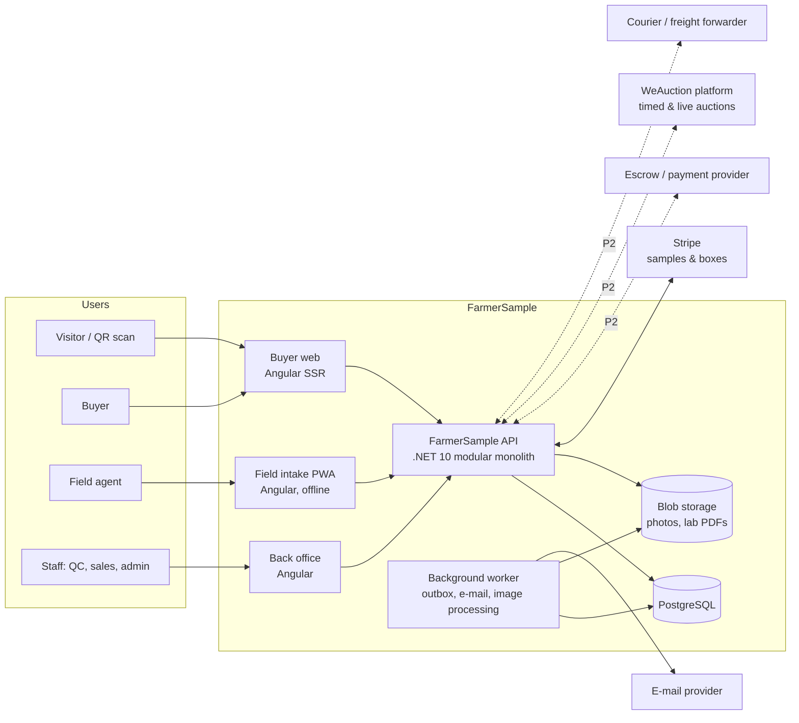
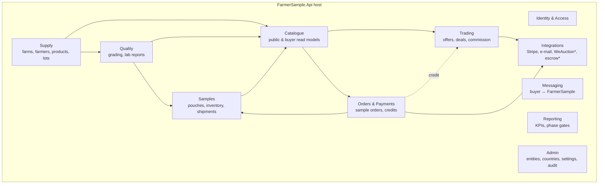
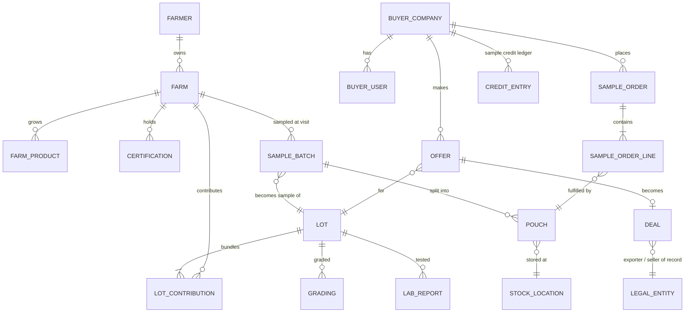
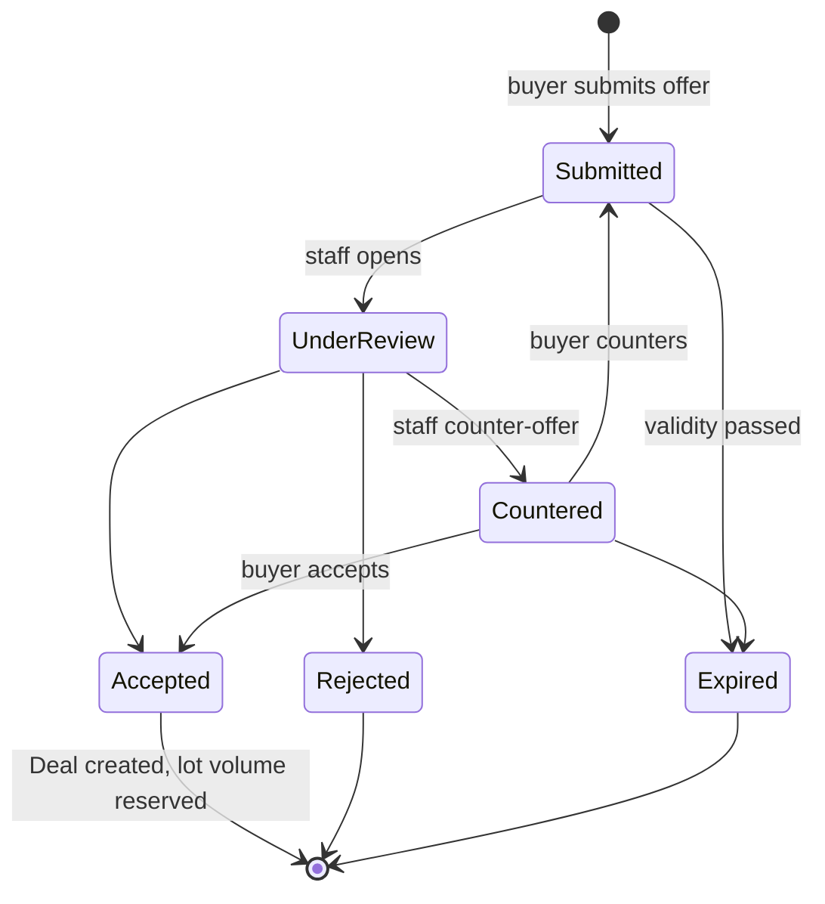
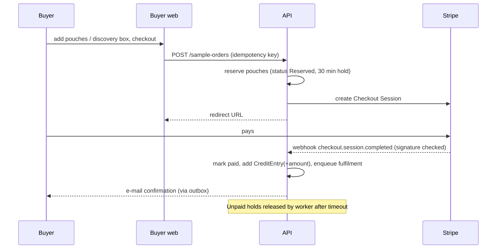

# FarmerSample.com — Development Architecture (v0.1)

Status: draft for review · Owner: Paul (WeAuction) · Source: FarmerSample.com Business Plan draft v0.1 (9 Nov 2026)

## 0. Summary of decisions

| # | Decision | Choice |
|---|----------|--------|
| D1 | Overall shape | **Modular monolith**: one .NET API, one PostgreSQL database with a schema per module, three Angular front-ends. No microservices until there is a proven need. |
| D2 | Stack | **.NET 10 (LTS) / C#**, **ASP.NET Core**, **EF Core + Npgsql**, **PostgreSQL 17**, **Angular (current stable at scaffold time)**. Same language and framework family as WeAuction (.NET/C#, Angular, Azure), so Enigmatry and WeAuction developers can work on it. |
| D3 | Local first | The full stack runs on a laptop (Windows, macOS incl. Apple Silicon, Linux) with Docker Compose and one command. No cloud account is needed to develop, demo or test. Every cloud dependency has a local stand-in (Azurite for Blob Storage, Mailpit for e-mail, Stripe test mode + Stripe CLI for payments). |
| D4 | Cloud later | Azure (Container Apps, Database for PostgreSQL Flexible Server, Blob Storage, Key Vault) when the showroom goes public. Region: EU (West Europe / Spain Central) because buyer data and the EU entity sit in the EU. |
| D5 | Auctions | **Not rebuilt.** Phase 2 auctions run on the existing **WeAuction platform**. FarmerSample pushes lots to WeAuction and receives results back through an integration module (anti-corruption layer). |
| D6 | Money | FarmerSample never holds buyer money itself. Phase 1: Stripe Checkout for paid samples/discovery boxes; deals are invoiced by the exporter of record. Phase 2 escrow goes through a **regulated payment/escrow provider** (to be selected), not our own bank account. |
| D7 | Anti-bypass by design | Farmer contact details and exact farm GPS are **never** exposed to buyers, in the UI, the API, QR pages, image metadata or exports. All buyer–seller communication runs through FarmerSample. |
| D8 | Field app | Farm intake is an **offline-capable PWA** (phone/tablet) because coverage at farms is unreliable. Records sync later with idempotent uploads. |

## 1. Context

### 1.1 What the business needs, by phase (from the business plan)

| Phase | When | Business capability | Platform scope |
|-------|------|---------------------|----------------|
| P0 Showcase | Nov 2026 – Jan 2027 | Show the EDB, farmers and first buyers what we do | Public website, farm profiles, QR codes, "request a sample" form, staff back office, field intake app |
| P1 Sample showroom | Feb – Sep 2027 | Paid samples and discovery boxes, offers, negotiated deals (5% commission), closed buyers group, European sample stock | Buyer accounts (invite only), sample catalogue with "valid until" + volume, Stripe payments, sample credits, offer workflow, deal records, sample inventory (Sri Lanka hub + EU stock), KPI dashboard for the phase gate |
| P2 Deals + auctions | from Oct 2027 | Escrow, logistics, timed auctions every two weeks, live hybrid auctions in peak season, memberships, Ceylon Spice Awards | Escrow via provider, shipment tracking, WeAuction integration, memberships, competition module |
| P3 Kerala | 2029 | Second country, INR, local partner | Multi-country / multi-currency already in the model; country-specific rules (e.g. cardamom excluded) |

The phase gates in the business plan (20+ sample buyers, 10–20 % sample-to-offer, first 5–10 deals) must be **measurable from the platform's own data** (see §11).

### 1.2 Users and roles

| Role | Who | Main app |
|------|-----|----------|
| Visitor | Anyone, incl. someone scanning a farm QR code | Buyer web (public part) |
| Buyer | Invited importer, grinder, packer, retailer (closed group) | Buyer web |
| Buyer admin | Person managing a buyer company's users | Buyer web |
| Field agent | Saj's team doing farm visits | Field intake PWA |
| Quality controller | Hub staff grading and sealing samples | Back office |
| Sales/ops | Paul, Saj, operations coordinator: publish profiles, handle orders, negotiate offers, record deals | Back office |
| Admin | Platform settings, users, legal entities, prices | Back office |

Farmers do **not** log in during P0–P1. They are represented by profiles managed by staff. (A farmer view in Sinhala/Tamil is a later option.)

### 1.3 Constraints and quality goals

- **Small team, fast first version**: Paul needs something to show the EDB this winter. Prefer boring, well-known technology and managed services.
- **Trust**: grading results, sample seals, prices and deal records must be auditable (who changed what, when).
- **Bypass protection** (D7) is a business-critical requirement, not a nice-to-have.
- **Low bandwidth**: farm visits in rural Sri Lanka; public pages must be fast on mobile networks.
- **Two legal entities**: a Sri Lankan company (sourcing, hub, export) and a European company (sample stock, buyer contracts, escrow). Every money-related record must name the entity.
- **Privacy**: EU GDPR for buyers and the EU entity; Sri Lanka Personal Data Protection Act (No. 9 of 2022) for farmer data. Data minimisation for farmers.
- **Cost**: hosting must stay well within the plan's EUR 24k/year platform budget.

## 2. Architecture principles

1. **One deployable, clear modules.** Modules talk through public C# interfaces and in-process domain events, never through each other's tables.
2. **Local parity.** What runs in Azure runs in Docker on a laptop. Configuration differs, code does not.
3. **Design for P2, build for P0/P1.** Model lots, money, entities and countries properly now; do not build escrow or auctions yet.
4. **Server is the source of truth.** Front-ends hold no business rules beyond input validation.
5. **Everything important is an event in the audit log.**
6. **Public by allow-list.** Public DTOs are separate classes from internal ones, so a new internal field (phone, GPS) can never leak by accident.

## 3. System context



Local stand-ins: Stripe test mode + Stripe CLI webhook forwarding, Mailpit, Azurite. WeAuction and escrow are faked by stub adapters until P2.

## 4. Technology stack

| Concern | Choice | Why |
|---------|--------|-----|
| Backend | .NET 10 LTS, ASP.NET Core Minimal APIs grouped per module | Team knows it (WeAuction); LTS until Nov 2028 |
| Data access | EF Core 10 + Npgsql; one `DbContext` per module, one PostgreSQL schema per module | Enforces module boundaries; migrations per module |
| Database | PostgreSQL 17 | Runs natively on every laptop incl. Apple Silicon; cheap managed option in Azure; built-in full-text search and PostGIS if needed later |
| Files | Azure Blob Storage (Azurite locally) via `Azure.Storage.Blobs` | Same SDK local and cloud |
| Background work | Transactional outbox table + `BackgroundService` worker (same codebase, separate process) | No extra infrastructure; reliable e-mails/webhooks |
| Auth | ASP.NET Core Identity in the API, cookie sessions (BFF pattern: front-ends served from the same site, no tokens in the browser), passkeys/TOTP MFA required for staff | Simple, secure, no external IdP needed locally; can federate to Entra ID for staff later |
| API contract | OpenAPI document generated at build; TypeScript client generated for Angular | One source of truth for front-end/back-end |
| Front-end | Angular workspace with 3 apps + shared libraries; Angular SSR for the buyer web (fast first paint, SEO for farm pages); PWA service worker for field intake | Matches WeAuction front-end skills |
| UI kit | Angular Material + a small design-token library | Fast, accessible |
| i18n | English first; Angular i18n set up from day one; Sinhala and Tamil for field app labels in P1 | Field agents and farmers |
| Payments | Stripe Checkout + webhooks (P1) | Cards, iDEAL, SEPA, Bizum not needed day one; test mode locally |
| E-mail | Any SMTP/API provider (Azure Communication Services or Postmark); Mailpit locally | |
| Observability | OpenTelemetry (traces, metrics, logs) → Aspire Dashboard container locally, Azure Monitor / Application Insights in cloud | Same instrumentation everywhere |
| Testing | xUnit, Testcontainers (real PostgreSQL in tests), Playwright for end-to-end | |
| CI | GitHub Actions: build, test, lint, OpenAPI diff, container build | |

## 5. Module structure


`*` = P2.

| Module | Owns | Key rules |
|--------|------|-----------|
| Identity & Access | Users, buyer companies, invitations, roles, sessions | Buyers are invite-only; staff need MFA |
| Supply | Farmer, Farm, Plot (optional), Product, Harvest window, Certification, **Lot** and **LotContribution** (bundling of farms) | Farm exact GPS + farmer contacts are `internal` fields; a Lot has one product + grade, one or more contributing farms |
| Quality | Grading record (moisture, density g/L, cleanliness, grade), lab report (piperine/oil, residues, aflatoxin, micro) as PDF + structured values | Grading results are immutable; corrections are new versions with reason |
| Samples | Sample batch (1–2 kg taken at the farm), **Pouch** (numbered, sealed, QR), stock location (LK hub, EU stock), stock movements, monthly consolidated shipment to EU | Every pouch belongs to exactly one lot; pouch count is derived from movements |
| Catalogue | Read models: public farm profile, buyer lot listing with indicative price range, "valid until", volume available | Built only from allow-listed public fields |
| Orders & Payments | Sample order, discovery box, Stripe checkout session, payment, refund, **sample credit ledger** | Price paid for samples is credited against the buyer's first deal |
| Trading | Offer (product, volume, price, Incoterm, delivery window, currency), counter-offers, Deal, commission receivable, exporter of record | Offer state machine (§6.3); a deal reserves lot volume |
| Messaging | Threads between a buyer and FarmerSample staff, attached to an offer/lot/order | Outgoing staff messages are scanned for phone numbers/e-mails before sending (warning) |
| Reporting | Funnel metrics and phase-gate dashboard | Reads from module events, not tables |
| Admin | Legal entities, countries, currencies, FX rates, price lists, feature flags, audit log viewer | |
| Integrations | Adapters behind interfaces: `IPaymentGateway`, `IEmailSender`, `IAuctionPlatform`, `IEscrowProvider`, `IFxRateSource` | Each has a fake for local/dev/test |

Each module is a separate C# project (`FarmerSample.Modules.<Name>`) with `Contracts` (public interfaces, DTOs, events) and an internal implementation. An architecture test (NetArchTest or ArchUnitNET) fails the build if a module references another module's internals.

## 6. Domain model

### 6.1 Core entities



Key attributes (abbreviated):

- **Lot**: `LotCode` (human-readable, e.g. `LK-PEP-2701-0042`), product, grade (e.g. pepper 550 g/L, cinnamon Alba/C5/C4), country, region, harvest window, **available volume (kg) + reserved volume**, indicative price range (min/max per kg, currency, Incoterm), `ValidUntil`, status (`Draft → Graded → Published → PartlyReserved → SoldOut / Expired / Withdrawn`), farmer share disclosure (% of price to farmer, filled in when the deal closes).
- **Pouch**: `PouchCode` (sequential, printed on seal), lot, weight (g), seal number, QR URL, current location, status (`Sealed → InStock(LK) → InTransit → InStock(EU) → Reserved → Shipped → Delivered / Destroyed`).
- **Grading**: lot, method, moisture %, density g/L, cleanliness, grade, operator, timestamp, photos, version.
- **SampleOrder**: buyer company, lines (pouch or discovery box), price, currency, Stripe session/payment ids, ship-from location (EU stock preferred for EU buyers), status, credit issued.
- **Offer**: lot, buyer company, volume kg, price/kg, currency, Incoterm (FOB Colombo / CIF port), delivery window, validity, status, version history (counter-offers are new versions).
- **Deal**: offer, final terms, exporter of record (legal entity), commission % and amount, sample credit applied, status (`Agreed → Contracted → Shipped → Completed / Cancelled`).

### 6.2 Value objects and conventions

- **Money**: amount in minor units (`long`) + ISO-4217 currency (EUR, USD, LKR; INR later). No floating point. Conversions store the FX rate and source used.
- **Weights** in grams (`long`), density in g/L, volumes in kg on the API.
- **IDs**: UUID v7 (`Guid.CreateVersion7()`) internally; separate short **public codes** for lots and pouches. Public URLs never contain internal IDs of farmers.
- **Time**: UTC in the database, `DateTimeOffset` in .NET; display in the user's time zone (Sri Lanka UTC+5:30, Spain CET).
- **Countries/regions**: ISO-3166 + our own region list (Gampola/Kandy, Bibile, Middeniya, Maspanna to start), so Kerala is just new reference data.

### 6.3 State machines (P1)



Rule: accepting an offer reserves lot volume in the same transaction; if available volume is too low the accept fails (optimistic concurrency on the lot row via PostgreSQL `xmin`).

## 7. Key flows

### 7.1 Farm visit (offline)

1. Field agent opens the PWA (already logged in; session cached), creates Farmer + Farm, records products, hectares, harvest window, certifications, photos, and the sample batch (weight, product).
2. Each record gets a **client-generated UUID** and is stored in IndexedDB with an outbox queue.
3. When online, the app syncs: `PUT /api/v1/intake/{clientId}` (idempotent upsert); photos upload in chunks to a short-lived, write-only blob SAS URL, then are confirmed.
4. The server marks the intake as **"needs review"**; a staff member checks and publishes. Field data never goes live without review.
5. The worker strips EXIF (incl. GPS) from public image renditions and creates resized versions (WebP).

Conflict rule: intake records are only editable on the device until synced; after sync, edits happen in the back office.

### 7.2 Grade, seal, list

1. Hub receives the sample batch (scan the batch label), dries, grades → Grading record.
2. Back office creates/links the Lot (one or several farms of the same grade = bundling), splits the batch into pouches and prints labels with pouch code + QR (PDF label sheet for a standard label printer).
3. Staff sets indicative price range, available volume and `ValidUntil`, then publishes → Catalogue read models update via domain event.

### 7.3 Order a sample / discovery box (P1)



Fulfilment: staff picks pouches from EU stock (1–3 days) or the LK hub, enters the courier tracking number. Courier APIs are not integrated in P1.

### 7.4 Offer → deal (P1)

Buyer makes an offer on a published lot → staff negotiates in the offer thread → accept creates a Deal, reserves volume, applies available sample credit, records commission (5 % in P1, configurable per deal) and the exporter of record. Contract and invoice are produced outside the platform in P1 (PDF upload to the deal); the platform tracks status and commission receivable.

### 7.5 QR scan

QR on a pouch or farm sign → `https://farmersample.com/q/{code}` → public page with farm story, region (not exact location), products, certifications, lab summary of the lot. No contact details. Rate-limited, cacheable, SSR.

## 8. Front-end applications

| App | Path (local) | Rendering | Notes |
|-----|--------------|-----------|-------|
| `buyer-web` | `http://localhost:4200` | Angular SSR | Public pages (home, farms, QR, "request access") + logged-in buyer area (catalogue, sample orders, offers, deals, messages, credits) |
| `backoffice` | `http://localhost:4201` | SPA | Staff only, MFA. Intake review, lots, grading, pouches, labels, orders, offers/deals, buyers/invites, reports, audit |
| `field-intake` | `http://localhost:4202` | PWA, offline | Phone-first, large touch targets, works on low-end Android; English + Sinhala/Tamil labels |

Shared libraries: `ui` (design tokens, components), `api-client` (generated), `i18n`, `auth`.

In local dev each Angular dev server proxies `/api` to the API, so cookies stay same-origin. In Azure, a single front door (Container Apps ingress or Front Door) serves front-ends and `/api` on the same site.

## 9. Security and privacy

- **Authentication**: ASP.NET Core Identity, secure HttpOnly SameSite cookies, CSRF protection (antiforgery token header) on state-changing requests. Staff: MFA mandatory. Buyers: invite link → set password/passkey; MFA optional, encouraged.
- **Authorization**: role + resource policies (a buyer only sees its own company's orders, offers, deals, credits). Policies are unit-tested.
- **Bypass protection (D7)**: public/buyer DTOs are explicit allow-lists; an automated test serialises every public/buyer endpoint response with seeded "canary" contact data and fails if a phone, e-mail or GPS coordinate appears. Images are re-encoded without metadata. Exports for buyers exclude farmer identities beyond profile name.
- **Personal data**: farmer phone/NIC/bank details only if needed, stored in an `internal` schema, encrypted at column level for bank details (keys in Key Vault; local dev key in user secrets). Retention and deletion procedure documented; data subject requests handled via back office.
- **Webhooks**: Stripe signature verification, idempotent processing by event ID.
- **Secrets**: never in git. Local: `dotnet user-secrets` + `.env` (git-ignored, `.env.example` committed). Cloud: Key Vault + managed identity.
- **Rate limiting**: ASP.NET Core rate limiter on public, login, QR and offer endpoints.
- **Audit log**: append-only table (who, what, when, before/after) for grading, prices, lots, offers, deals, payments, user/role changes.
- **Dependencies**: Dependabot + `dotnet list package --vulnerable` + `npm audit` in CI.

## 10. Local-first development environment

### 10.1 Prerequisites

Docker Desktop (or Docker Engine/Podman with Compose v2), .NET 10 SDK, Node.js LTS, Git. Optional: Stripe CLI (also available as a Compose service).

### 10.2 Repository layout

```
farmersample/
├── docs/                      architecture, ADRs (docs/adr/0001-*.md)
├── src/
│   ├── FarmerSample.Api/              host: endpoints, auth, OpenAPI
│   ├── FarmerSample.Worker/           outbox, e-mail, image processing, timeouts
│   ├── FarmerSample.SharedKernel/     Money, Weight, Result, domain events
│   ├── FarmerSample.Modules.Identity/
│   ├── FarmerSample.Modules.Supply/
│   ├── FarmerSample.Modules.Quality/
│   ├── FarmerSample.Modules.Samples/
│   ├── FarmerSample.Modules.Catalogue/
│   ├── FarmerSample.Modules.Orders/
│   ├── FarmerSample.Modules.Trading/
│   ├── FarmerSample.Modules.Messaging/
│   ├── FarmerSample.Modules.Reporting/
│   ├── FarmerSample.Modules.Admin/
│   ├── FarmerSample.Integrations/     Stripe, e-mail, fakes; WeAuction/escrow stubs
│   └── FarmerSample.DbMigrator/       applies all module migrations + seed data
├── tests/
│   ├── *.UnitTests, *.IntegrationTests (Testcontainers)
│   ├── FarmerSample.ArchitectureTests
│   └── e2e/ (Playwright)
├── web/                       Angular workspace: projects/buyer-web, backoffice, field-intake, libs/*
├── deploy/
│   ├── docker-compose.yml
│   ├── docker-compose.override.example.yml
│   └── azure/ (Bicep, later)
├── .env.example
├── Makefile + dev.ps1           same commands on macOS/Linux and Windows
└── README.md
```

### 10.3 Docker Compose services

| Service | Image | Port(s) | Purpose |
|---------|-------|---------|---------|
| `postgres` | `postgres:17` | 5432 | Database (volume `pgdata`) |
| `azurite` | `mcr.microsoft.com/azure-storage/azurite` | 10000 | Blob storage emulator |
| `mailpit` | `axllent/mailpit` | 1025 (SMTP), 8025 (UI) | Catch all outgoing e-mail |
| `otel` | `mcr.microsoft.com/dotnet/aspire-dashboard` | 18888 (UI), 4317 (OTLP) | Traces, logs, metrics |
| `stripe-cli` *(profile `payments`)* | `stripe/stripe-cli` | – | Forwards Stripe test webhooks to the API |
| `migrator` *(profile `app`)* | built from repo | – | Runs migrations + seed, then exits |
| `api` *(profile `app`)* | built from repo | 8080 | API |
| `worker` *(profile `app`)* | built from repo | – | Background jobs |
| `web` *(profile `app`)* | built from repo (nginx/Node SSR) | 4200–4202 | Front-ends |

Two ways to run:

- **Developer mode** (fast feedback): `make infra` (Postgres, Azurite, Mailpit, OTel only), then `dotnet watch` for the API and `npm start` for the Angular apps on the host.
- **Demo mode** (one command, nothing but Docker needed): `docker compose --profile app up --build` runs everything in containers — this is what Paul uses to demo to the EDB from a laptop.

### 10.4 Commands

| Command | Does |
|---------|------|
| `make setup` | copies `.env.example` → `.env`, restores .NET tools, `npm ci`, trusts dev HTTPS cert |
| `make infra` | starts infrastructure containers |
| `make db` | applies migrations and loads seed data (demo farms in Kandy/Bibile, lots, pouches, 3 demo buyers, staff users) |
| `make api` / `make web` | runs API / all front-ends with hot reload |
| `make test` | unit + architecture + integration tests |
| `make e2e` | Playwright against demo mode |
| `make reset` | drops volumes and rebuilds from scratch |
| `make demo` | `docker compose --profile app up --build` |

Seed data is **fictional** (no real farmer data in the repo). Default local logins are printed at the end of `make db`.

### 10.5 Local configuration

`appsettings.Development.json` points at the Compose services; secrets (Stripe test keys) come from `.env`/user secrets. Feature flags (e.g. `Payments:Enabled=false`) let the site run without any Stripe account — sample orders then become "requests" handled by staff, which is exactly the P0 behaviour.

## 11. Reporting and phase gates

The Reporting module turns events into the business plan's gate metrics:

| Metric | Source events |
|--------|---------------|
| Buyers ordering samples; buyers ordering again | `SampleOrderPaid` per buyer company |
| Sample → offer conversion (10–20 % target) | `SampleOrderPaid`, `OfferSubmitted` on the same lot within N days |
| Offers that close | `OfferAccepted`, `DealCompleted` |
| Price to farmer vs local trader price | Deal farmer share vs reference price entered by staff |
| Time from farm visit to sample in EU (target ~2 weeks) | `SampleBatchCreated` → `PouchArrivedEU` |
| Time from sample to offer (target ≤ 1–1.5 months) | `SampleDelivered` → `OfferSubmitted` |

Shown on a back-office dashboard; CSV export.

## 12. Quality and testing

- Unit tests for domain rules (money, state machines, credit ledger, volume reservation).
- Integration tests per module against real PostgreSQL (Testcontainers) and Azurite.
- Architecture tests for module boundaries.
- **Privacy canary test** (§9) on every public/buyer endpoint.
- Contract test: OpenAPI diff in CI to catch breaking changes for the generated client.
- Playwright smoke tests: QR page, buyer login, sample checkout (Stripe test card), offer → deal.
- Code style: `dotnet format`, ESLint, Prettier; pre-commit hooks optional.

## 13. Path to Azure (when P1 goes public)

| Local | Azure |
|-------|-------|
| `api`, `worker`, `web` containers | Azure Container Apps (scale to zero for worker allowed; API min 1 replica) |
| `postgres` | Azure Database for PostgreSQL Flexible Server (Burstable tier to start), automated backups, PITR |
| `azurite` | Azure Blob Storage (private container for originals and lab PDFs; public CDN only for processed public images) |
| `mailpit` | Azure Communication Services Email or Postmark |
| `otel` dashboard | Application Insights / Azure Monitor (OTLP exporter) |
| `.env` / user secrets | Key Vault + managed identity |

Infrastructure as code with Bicep; GitHub Actions deploys `main` to `test`, tagged releases to `prod`. Database migrations run as a Container Apps job before the new revision takes traffic. Environments: `local`, `test`, `prod`.

## 14. P2+ extension points (designed now, built later)

- **Auctions (WeAuction)**: `IAuctionPlatform` with `PublishLot`, `GetAuctionResult`, webhook `LotSold`. A published lot can be moved into an auction sale; result creates a Deal through the same Trading module. Bidding, streaming and live hybrid stay entirely in WeAuction. Lot and buyer identity mapping tables live in the Integrations module.
- **Escrow**: `IEscrowProvider` (create escrow, fund, release on shipment/acceptance, refund). Provider choice and licensing to be decided with legal advice; the EU entity is the contracting party.
- **Logistics**: shipment, documents (phytosanitary, certificate of origin, lab report) attached to deals; freight forwarder integration later.
- **Membership**: plans (Trade, Partner) with included sample boxes → Orders module.
- **Ceylon Spice Awards**: competition entries, jury scoring, winning lots → special auction.
- **Kerala**: new country/region/currency reference data, country rules (e.g. cardamom excluded), Indian legal entity.
- **Farmer access**: read-only farmer portal or SMS/WhatsApp notifications in Sinhala/Tamil.
- **Own trading book**: separate legal entity treated as an ordinary buyer account, with disclosed house bids.

## 15. Delivery plan for the first versions

| Milestone | Target | Content |
|-----------|--------|---------|
| M0 Skeleton | week 1–2 | Repo, Compose, CI, auth, module skeletons, migrations, seed data, OTel |
| M1 Showcase (P0) | before the EDB meeting | Field intake PWA, intake review, farm profiles, QR pages, lots with gradings, public site, "request a sample" (no payment) |
| M2 Showroom (P1 start) | Feb 2027 | Buyer invites/accounts, catalogue, pouches & stock locations, labels, Stripe sample orders, credit ledger, e-mails |
| M3 Trading | Mar–Apr 2027 | Offers, counter-offers, deals, commission, messaging, KPI dashboard |
| M4 Hardening | before go-live | Azure deploy, backups, privacy review, pen-test light, GDPR/PDPA documentation |

## 16. Open questions / ADRs to write

1. Exporter of record per deal: Saj's company or a licensed exporter? (affects Deal and invoicing)
2. Which EU entity (Netherlands or Spain) contracts with buyers and sells samples? (Stripe account owner, VAT)
3. VAT/OSS treatment of paid samples shipped from Spain to other EU countries; import rules for commercial food samples.
4. Escrow provider selection (P2) and whether the EU entity needs to be a payment agent.
5. Who in Sri Lanka holds farmer personal data and under which entity (PDPA controller).
6. WeAuction API capabilities needed for lot import and result callback (check with Enigmatry).
7. Whether the field app must support Sinhala/Tamil from M1 or M2.
